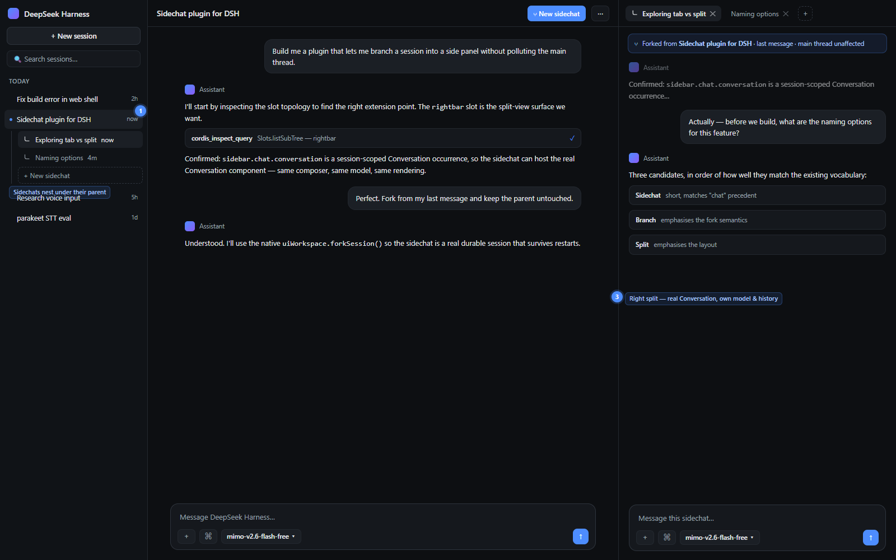

# dsh-sidechat

A [DeepSeek Harness](https://github.com/deepseek-ai/deepseek-harness) plugin that branches the current session into a **sidechat** — a real forked session that opens in the right split view with the *exact same* conversation UI, leaving the main session completely untouched.

Useful when you want to explore a tangent without polluting the main thread: the parent keeps running, and you can talk to both in parallel.

## Features

- **Real forks, not copies.** A sidechat is a genuine forked session created with the harness's native fork, so it inherits the full message history and every committed event.
- **Genuine UI clone.** The sidechat hosts the *actual* Conversation component — same composer, same model selector, same message rendering, same tool cards. It is not a reduced "mini chat".
- **Right split view.** Opens in the right sidebar as a tab alongside the parent, so both sessions are live at once.
- **Independent.** Continue the sidechat (and the parent) however you like; neither affects the other.
- **Durable.** Sidechats are normal sessions, and the tab addresses are durable — an open sidechat comes back after a restart.
- **Multiple at once.** Each sidechat opens as its own tab.
- **`/side` command.** Type `/side` in the composer to fork the current session into a sidechat. It is a client-owned command, so it appends **no** event to the conversation — the parent's log stays exactly as it was.
- **Grouped under the parent.** A session's sidechats are listed as an indented tree in its sidebar hover card, with their relative times, and open on click.
- **Theme and locale aware.** Uses host theme tokens and registers translations (English and Chinese).

## Install

Requires a DeepSeek Harness installation that supports bundles (0.2.x).

1. Clone or copy this directory somewhere permanent.
2. Install it as a bundle — either:
   - through the Plugin Manager UI (**install bundle** → select this directory), or
   - by having the agent install it: `plugin_manager` with `action: install_bundle` and `target` set to the absolute path of this directory.
3. Reload the harness page so the client module loads.

## Usage

- Type `/side` in the composer, or
- hover a session row in the sidebar and click the **branch** button, or
- open that session's `⋯` menu and choose **New sidechat**.

The sidechat forks from the current point of the session and opens in the right split view.

Sidechat rows show a small branch glyph. A parent session's hover card lists its sidechats as an indented tree — click one to open its tab; a sidechat's own hover card names the session it was branched from.

## How it works

- `client.js` registers a resource provider (`dsh-resource://sidechat/session/<childId>`) that retains the forked session and releases it when the tab closes.
- It declares a right-sidebar tab kind (`sidechat`) plus a tab body that binds the retained session through `SessionProvider`.
- The conversation is rendered by the shared embedded Conversation factory (`conversation.content` with `variant: 'embedded'`), which is why the sidechat looks and behaves identically to the main session.
- `/side` is contributed to the client `commandUi` registry with `ui.kind: 'action'`, which runs in the browser and never sends a message or appends a session event.
- Forking uses the native `sessions.fork()`; the tab is opened with `sidebarRight.openResource()`.
- Parentage is resolved from three sources, strongest first: the explicit map this plugin records at fork time (`dsh.sidechat.links.v1`), the `parentSession` a fork writes into the child's stored header (surfaced as `parentId` in the session list), and the fork title convention `<parent title> (n)`. Sidechats created before the plugin tracked links — or with the shipped **Fork** item — therefore still nest correctly.
- `index.js` is the host half. It registers no services — everything is client-side.

## Sidebar tree (beta)

The shipped sidebar renders a flat session list: it hides subagent sessions entirely and nests only workspaces, so it has no hook for indenting a session under another. To get real child rows, this plugin can take over the `sidebar.workspaces` seat.

Type **`/sidebar-tree`** in the composer to turn it on or off (the page reloads). The setting is a browser flag, so it survives restarts, and the command always remains available in the composer — which means a misbehaving replacement can always be switched back off from there.

The replacement:

- renders workspace groups, session rows, search, archive filter, "Show more" expansion and empty states
- nests each parent's sidechats beneath it with a chevron, connector line and their own relative times
- **re-declares the shipped child slots** (`session.menu.item`, `session.row.action`, `row.leading`, `row.hover`, `directoryFlow`), so the shipped pin / rename / fork / archive / copy-id menu entries, the hover buttons, the hover-card content and other plugins' contributions keep working inside the new rows

Not yet in the replacement: drag-to-reorder rows, the shipped view-options menu (group/sort/archive cycling is on the two header buttons), hover-card copy affordances, and row motion animations. Turn it off with `/sidebar-tree` if you rely on those; the rest of the plugin keeps working either way.

## Known limitations

- **Fork boundary.** The fork uses the committed tail of the session, which is the end of the last completed assistant turn whenever the session is idle (the normal case). Starting a sidechat mid-stream captures the committed portion of the running turn.
- **Nesting needs the beta sidebar.** Without `/sidebar-tree`, the shipped flat list is used and sidechats appear as siblings with a branch glyph, grouped under their parent in the hover card.
- **Links are per browser.** The explicit map lives in `localStorage`. Sessions forked from this browser keep their position through the stored `parentSession` header even if the map is cleared; sessions forked elsewhere rely on that header (or the title convention) rather than the map.
- **Model selection.** The composer model selector follows the sidechat session's own selection, exactly like any other session.

## License

MIT