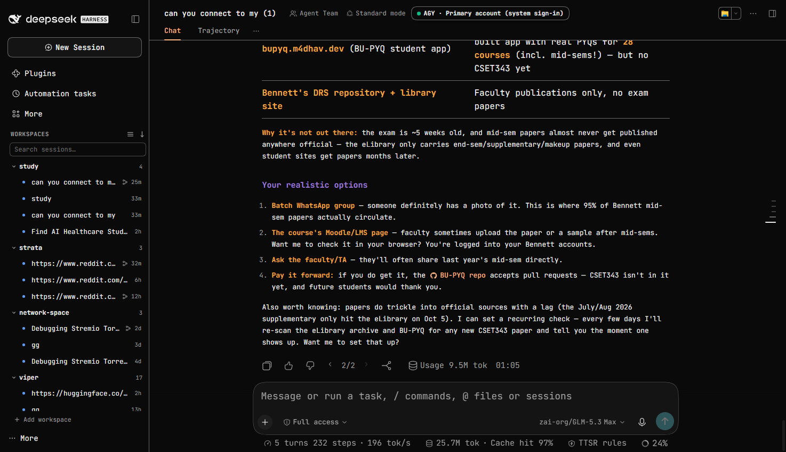
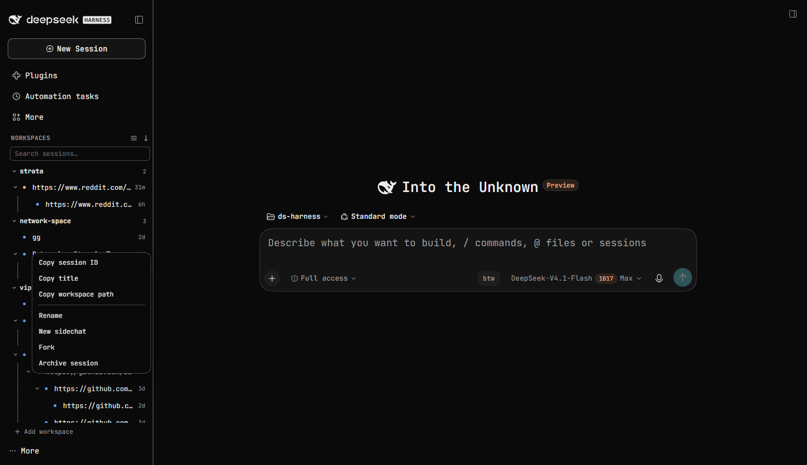

# dsh-sidechat

A [DeepSeek Harness](https://github.com/deepseek-ai/deepseek-harness) plugin that branches the current session into a **sidechat** — a real forked session that opens in the right split view with the *exact same* conversation UI, leaving the main session completely untouched.

Useful when you want to explore a tangent without polluting the main thread: the parent keeps running, and you can talk to both in parallel.

## Features

- **Real forks, not copies.** A sidechat is a genuine forked session created with the harness's native fork, so it inherits the full message history and every committed event.
- **Genuine UI clone.** The sidechat hosts the *actual* Conversation component — same composer, same model selector, same message rendering, same tool cards. It is not a reduced "mini chat".
- **Right split view.** Opens in the right sidebar as a tab alongside the parent, so both sessions are live at once.
- **Independent.** Continue the sidechat (and the parent) however you like; neither affects the other.
- **Durable.** Sidechats are normal sessions, and the tab addresses are durable — an open sidechat comes back after a restart.
- **Multiple at once.** Each sidechat opens as its own tab.
- **`/side` command.** Type `/side` in the composer to fork the current session into a sidechat. It is a client-owned command, so it appends **no** event to the conversation — the parent's log stays exactly as it was.
- **Grouped under the parent.** Sidechats are indented beneath their parent session in the sidebar tree, with their own chevron and relative time. Clicking a child row opens the parent on the main stage and the sidechat in the right split view.
- **Normal forks stay normal.** The row menu's **Fork** creates an ordinary, top-level session and opens it in the main pane — only `/side` and the branch button create sidechats. A forked session shows a small **fork glyph** (hover it to see which session it came from).
- **Live indicator.** A running session shows a spinning ring instead of the static status dot.

- **Theme and locale aware.** Uses host theme tokens and registers translations (English and Chinese).

## Install

Requires a DeepSeek Harness installation that supports bundles (0.2.x).

1. Clone or copy this directory somewhere permanent.
2. Install it as a bundle — either:
   - through the Plugin Manager UI (**install bundle** → select this directory), or
   - by having the agent install it: `plugin_manager` with `action: install_bundle` and `target` set to the absolute path of this directory.
3. Reload the harness page so the client module loads.

## Usage

- Type `/side` in the composer, or
- hover a session row in the sidebar and click the **branch** button, or
- open that session's `⋯` menu and choose **New sidechat**.

The sidechat forks from the current point of the session and opens in the right split view.

Sidechat rows show a branch glyph. A child row is indented under its parent; clicking it opens the parent in the main pane and the sidechat in the right split view. Hovering a row reveals its **branch** and `⋯` buttons as an overlay, so the list never reflows; the `⋯` menu offers Rename, New sidechat, Fork and Archive session.

**Right-click any session row** (or press Shift+F10 / the menu key while it is focused) for the row's context menu:

- **Copy session ID**, **Copy title**, and **Copy workspace path** (when the session belongs to a workspace) — each confirms with a short toast
- Rename, New sidechat, Fork and Archive session
- **Detach from parent** on a sidechat row: keeps the session but makes it a normal top-level fork (handy for forks recorded as sidechats by older versions)

## How it works

- `client.js` registers a resource provider (`dsh-resource://sidechat/session/<childId>`) that retains the forked session and releases it when the tab closes.
- It declares a right-sidebar tab kind (`sidechat`) plus a tab body that binds the retained session through `SessionProvider`.
- The conversation is rendered by the shared embedded Conversation factory (`conversation.content` with `variant: 'embedded'`), which is why the sidechat looks and behaves identically to the main session.
- `/side` is contributed to the client `commandUi` registry with `ui.kind: 'action'`, which runs in the browser and never sends a message or appends a session event.
- Forking uses the native `sessions.fork()`; the tab is opened with `sidebarRight.openResource()`.
- Parentage has two separate notions. A **sidechat** is a child only when this plugin recorded the fork in its link map (`dsh.sidechat.links.v1`); a **normal fork** is a full session, and its header lineage (republished by `index.js` as `projectionValues.sidechat.parentId`) is used solely for the fork glyph and its tooltip.
- `index.js` registers that one projection; everything else is client-side.

## Sidebar tree

The shipped sidebar renders a flat session list: it hides subagent sessions entirely and nests only workspaces, so it has no hook for indenting a session under another. To get real child rows, this plugin takes over the `sidebar.workspaces` seat. **This is on by default** — no setup step.

If you ever want the default list back, type **`/sidebar-tree`** in the composer (the page reloads). Type it again to switch back. The setting survives restarts, and the command always works from the composer, so a bad render can always be undone.

The replacement:

- renders workspace groups, session rows, search, archive filter, "Show more" expansion and empty states
- nests each parent's sidechats beneath it with a chevron, connector line and their own relative times
- keeps row actions (`branch`, `⋯`) as an absolutely-positioned overlay revealed on hover or focus, so opening them never shifts the list, and anchors the action menu to the row as a fixed popover
- opens a right-click context menu per session with the copy actions (session ID, title, workspace path) plus rename / sidechat / fork / archive

Not yet in the replacement: drag-to-reorder rows, the shipped view-options menu (group/sort/archive cycling is on the two header buttons), the shipped hover card (message count and sidechat list — copy actions now live in the right-click menu), and row motion animations. Turn it off with `/sidebar-tree` if you rely on those; the rest of the plugin keeps working either way.

## Known limitations

- **Fork boundary.** The fork uses the committed tail of the session, which is the end of the last completed assistant turn whenever the session is idle (the normal case). Starting a sidechat mid-stream captures the committed portion of the running turn.
- **Nesting needs the sidebar tree.** With the tree turned off (`/sidebar-tree`), the default flat list is used and sidechats appear as sibling sessions (each still opens its own right-pane tab from the `⋯` menu).
- **Links are per browser.** Sidechat nesting comes from the browser's own link map, so a sidechat opened from another browser or machine shows up as a normal fork row (with the fork glyph). Use the right-click **Detach from parent** to turn an old child row into a plain fork.
- **Model selection.** The composer model selector follows the sidechat session's own selection, exactly like any other session.

## License

MIT